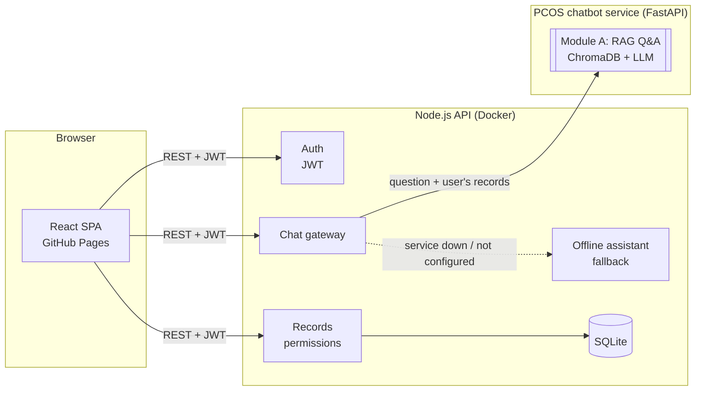

# Sharing App PCOS

## 1. Overview

Polycystic ovary syndrome (PCOS) affects an estimated 10–13% of women of reproductive age [1] and is diagnosed when two of three features are present: ovulatory dysfunction, hyperandrogenism, and polycystic ovarian morphology [2], [3]. Many of its symptoms are sensitive (cycles, hair growth, acne, fertility, weight), so patients often hesitate to ask about them, and short clinic visits leave little time to explain lab results.

This repository is the **app interface** of the PCOS care platform: a React frontend and a Node.js API centred on a **smart chatbot**. Patients ask about PCOS and about their own records in a judgment-free chat; doctors follow their patients' visits and ask the assistant to summarize them. The chatbot itself is the separate **[PCOS chatbot service](https://github.com/InnovHer-Competition/chat-bot)** (FastAPI + LangChain RAG over curated PCOS documents); this app is its user interface and gateway.

> [!IMPORTANT]
> The assistant and the PCOS assessment are decision support, not a diagnosis. Androgen and AMH thresholds are assay- and population-specific, and other causes must be excluded by a clinician.

---

## 2. System Architecture

### 2.1 Component Overview



### 2.2 Roles

- **Patient**
  - Full CRUD on their own records
  - Assistant sees: their own records
- **Doctor**
  - Reads, creates and updates records of any patient
  - Deletes only records they authored
  - Assistant sees: their patients' records

The rules are pure functions in [`packages/shared/src/permissions.ts`](packages/shared/src/permissions.ts), enforced by the API and reused by the UI and the chat gateway.

### 2.3 Chatbot Integration

`POST /api/chat` is the gateway to the chatbot service. For each message it:

1. builds a plain-text summary of the records the signed-in user may see ([`chat/context.ts`](apps/server/src/chat/context.ts));
2. calls `POST {CHATBOT_URL}/api/v1/chat` ([`chat/client.ts`](apps/server/src/chat/client.ts)):

   ```json
   { "message": "What is PCOS?", "history": [], "role": "patient", "context": "Signed-in user: … Your records …" }
   ```

   and expects `{ "reply": "…", "module_used": "Module A (RAG Q&A)" }`;
3. returns the reply to the browser, with `X-Chat-Mode: chatbot`.

The chatbot service currently reads only `message`, which its RAG retriever uses as the query. `history`, `role` and `context` are extra fields that FastAPI ignores until the service starts using them, so the contract is backwards compatible.

When `CHATBOT_URL` is not set, or the service fails or times out, a rule-based **offline assistant** answers common questions (what PCOS is, latest findings, BMI, LH:FSH, HOMA-IR, cycle trend) from the user's records, with `X-Chat-Mode: offline`. Development and demos therefore work without the Python service.

### 2.4 PCOS Assessment

[`packages/shared/src/pcos.ts`](packages/shared/src/pcos.ts) evaluates the Rotterdam criteria with the thresholds of the 2023 International Evidence-based Guideline [3]:

- **Ovulatory dysfunction:** cycles > 35 or < 21 days, or < 8 periods per year
- **Hyperandrogenism:** modified Ferriman–Gallwey score ≥ 4, acne or alopecia, or total testosterone above the reference range
- **Polycystic ovarian morphology:** ≥ 20 follicles per ovary or ovarian volume ≥ 10 mL

The latest known value of each measurement is carried forward across visits, so an earlier ultrasound still counts when a later visit only records labs. The result is mapped to phenotypes A–D. Derived metrics include BMI, LH:FSH ratio and HOMA-IR [4].

### 2.5 Technology Stack

**Frontend**
- **[React 19](https://react.dev/)** + **[Vite](https://vite.dev/)**: single-page app, hash routing for static hosting
- **[TypeScript](https://www.typescriptlang.org/)**: strict mode throughout
- **[assistant-ui](https://github.com/assistant-ui/assistant-ui)**: chat primitives and runtime for the assistant [5]
- Dependency-free SVG charts following an accessible, colour-blind-validated palette

**Backend**
- **[Express 5](https://expressjs.com/)**: REST API and chat gateway
- **[node:sqlite](https://nodejs.org/api/sqlite.html)**: embedded store (no native build step)
- **[jose](https://github.com/panva/jose)**: JWT sessions; **scrypt** password hashing
- **[Zod](https://zod.dev/)**: request validation

**Chatbot service** ([separate repository](https://github.com/InnovHer-Competition/chat-bot))
- **FastAPI**, **LangChain**, **ChromaDB**, HuggingFace embeddings and a local **Ollama** LLM

**Tooling & Delivery**
- **[pnpm](https://pnpm.io/) workspaces**: monorepo with a shared domain package
- **[Vitest](https://vitest.dev/)** + **[Supertest](https://github.com/ladjs/supertest)**: unit and API tests
- **[oxlint](https://oxc.rs/)**: linting
- **GitHub Actions**: CI, GitHub Pages deployment, Docker image publishing to GHCR

### 2.6 Monorepo Structure

```
app-interface/
├── apps/
│   ├── web/                     # React frontend (GitHub Pages)
│   │   └── src/
│   │       ├── pages/           # Sign in/up, assistant, dashboards, records, account
│   │       ├── components/      # Layout, charts, PCOS overview, record form, patient picker
│   │       ├── chat/            # assistant-ui adapter for /api/chat
│   │       └── lib/             # API client, auth context
│   │
│   └── server/                  # Node.js API (Docker image)
│       ├── src/
│       │   ├── routes/          # auth, records, patients
│       │   ├── chat/            # gateway, chatbot-service client, record context, offline fallback
│       │   ├── db.ts            # SQLite schema & repository
│       │   └── seed.ts          # demo accounts & records
│       ├── test/                # API tests (auth, permissions, chat gateway)
│       └── Dockerfile
│
├── packages/
│   └── shared/                  # Types, PCOS assessment, permissions (+ tests)
│
├── scripts/dev.mjs              # Runs API and web together (pnpm dev)
├── pnpm-workspace.yaml
└── .github/workflows/ci-cd.yml  # CI → Pages + GHCR
```

---

## 3. Development Workflow

### 3.1 Prerequisites

- **Node.js** 22.13+ (24 LTS recommended; `node:sqlite` is used without flags)
- **pnpm** 11+ (`corepack enable` picks up the pinned version from `package.json`)
- Optional: the **[PCOS chatbot service](https://github.com/InnovHer-Competition/chat-bot)** (Python 3.11, Ollama), **Docker** for the API image

### 3.2 Environment Setup

```bash
# 1. Clone the repository
git clone https://github.com/InnovHer-Competition/app-interface.git
cd app-interface

# 2. Install dependencies
pnpm install

# 3. Configure environment variables (optional for local development)
cp apps/server/.env.example apps/server/.env
cp apps/web/.env.example apps/web/.env.local

# 4. Start the API and the web app
pnpm dev
```

To use the real chatbot, start the chatbot service in its own checkout (see its README), then keep `CHATBOT_URL=http://localhost:8000` in `apps/server/.env`:

```bash
conda activate pcos-env
python run_ingest.py                       # builds data/chroma_db once
uvicorn app.main:app --port 8000
```

Once running:
- Web app: [localhost:5173](http://localhost:5173)
- API: [localhost:8787/api/health](http://localhost:8787/api/health) (`"chat": "chatbot"` or `"offline"`)
- Chatbot service: [localhost:8000/docs](http://localhost:8000/docs)

### 3.3 Demo Accounts

With `SEED_DEMO=true` (the default outside production), an empty database is seeded with the accounts below. The password for all of them is `Demo1234!`.

| Email | Role | Notes |
|---|---|---|
| `anna@demo.health` | Patient | 5 visits showing treatment response |
| `mai@demo.health` | Patient | Phenotype C |
| `linh@demo.health` | Patient | One visit, phenotype D |
| `dr.le@demo.health` | Doctor | Author of Anna's and Mai's visits |
| `dr.kim@demo.health` | Doctor | Author of Linh's visit |

### 3.4 Command Reference

```bash
pnpm dev             # Start API (8787) and web (5173)
pnpm build           # Build all workspaces
pnpm build:server    # Build only the API (used on Render)
pnpm start           # Run the built API (used on Render)
pnpm typecheck       # TypeScript checks across the workspace
pnpm lint            # Lint the frontend with oxlint
pnpm test            # Shared + API test suites
```

### 3.5 Configuration

| Variable | App | Default | Purpose |
|---|---|---|---|
| `VITE_API_URL` | web | `http://localhost:8787` | API base URL |
| `VITE_SHOW_DEMO_ACCOUNTS` | web | `true` | Show demo shortcuts on sign-in |
| `PORT` | server | `8787` | HTTP port |
| `DATABASE_PATH` | server | `./data/pcos.db` | SQLite file |
| `CORS_ORIGIN` | server | `http://localhost:5173` | Allowed browser origins (comma-separated) |
| `JWT_SECRET` | server | random in dev | **Required in production** |
| `JWT_TTL` | server | `8h` | Session lifetime |
| `SEED_DEMO` | server | `true` (dev) / `false` (prod) | Seed demo data |
| `CHATBOT_URL` | server | — | Base URL of the chatbot service; offline assistant when unset |
| `CHATBOT_TOKEN` | server | — | Optional bearer token sent to the chatbot service |
| `CHATBOT_TIMEOUT_MS` | server | `120000` | Time to wait for a chatbot reply before falling back |

---

## 4. API Reference

All routes are under `/api`; everything except sign-up and sign-in requires `Authorization: Bearer <token>`.

| Method | Path | Who | Description |
|---|---|---|---|
| `POST` | `/auth/signup` | anyone | Create account `{ name, email, password, role }` (`patient` or `doctor`) |
| `POST` | `/auth/signin` | anyone | Email + password sign-in |
| `GET` | `/auth/me` | signed in | Current user |
| `GET` | `/records[?patientId=]` | signed in | List readable records |
| `GET` · `PUT` · `DELETE` | `/records/:id` | per permissions | Read, replace, delete a record |
| `POST` | `/records` | signed in | Create a record |
| `GET` | `/patients` | doctor | Patient directory |
| `POST` | `/chat` | signed in | `{ messages }` → plain-text reply from the chatbot (§2.3) |

---

## 5. Deployment

### 5.1 CI/CD Pipeline

[`.github/workflows/ci-cd.yml`](.github/workflows/ci-cd.yml) runs on every pull request and on pushes to `main`:

| Job | Trigger | What it does |
|---|---|---|
| `test` | PR + `main` | `pnpm install --frozen-lockfile`, lint, typecheck, tests, build |
| `deploy-web` | `main` | Builds the frontend and deploys it to **GitHub Pages** |
| `publish-server` | `main` | Builds `apps/server/Dockerfile`, pushes `ghcr.io/<owner>/<repo>-api:latest` and `:sha-…`, and triggers the Render deploy hook when `API_DEPLOY_HOOK` is set |

### 5.2 Frontend: GitHub Pages

1. **Settings → Pages → Source:** select **GitHub Actions**.
2. **Settings → Secrets and variables → Actions → Variables:**
   - `API_URL`: public URL of the deployed API, e.g. `https://<service>.onrender.com`
   - `SHOW_DEMO_ACCOUNTS` *(optional)*: `false` to hide demo shortcuts
3. Push to `main`. The site is published at `https://<owner>.github.io/<repo>/`, i.e. [innovher-competition.github.io/app-interface](https://innovher-competition.github.io/app-interface/) for this repository.

### 5.3 Backend: Docker

```bash
# Build from the repository root
docker build -f apps/server/Dockerfile -t pcos-app-interface-api .

# Run with a persistent volume for the database
docker run -p 8787:8787 -v pcos-data:/data \
  -e JWT_SECRET=<random 64-hex> \
  -e CORS_ORIGIN=https://innovher-competition.github.io \
  -e CHATBOT_URL=https://<chatbot-service-host> \
  -e SEED_DEMO=true \
  pcos-app-interface-api
```

### 5.4 Backend: Render

The API is hosted on **[Render](https://render.com)** in the team workspace: [dashboard.render.com/w/tea-db3bhkt9fdbs73ajuhu0](https://dashboard.render.com/w/tea-db3bhkt9fdbs73ajuhu0), using Render's Node runtime from the repository root.

| Setting | Value |
|---|---|
| Language / Runtime | Node (version pinned to 24 by [`.node-version`](.node-version)) |
| Branch | `main` |
| Root directory | *(empty: repository root)* |
| Build command | `pnpm install --frozen-lockfile && pnpm build:server` |
| Start command | `pnpm start` |
| Health check path | `/api/health` |

**Environment variables:** `NODE_ENV=production`, `JWT_SECRET` (random secret), `CORS_ORIGIN=https://innovher-competition.github.io`, `SEED_DEMO`, `CHATBOT_URL` (public URL of the deployed chatbot service), and `DATABASE_PATH=/var/data/pcos.db` when a disk is mounted at `/var/data`. Render provides `PORT` automatically.

**Connect the frontend:** add the service URL (no trailing slash) as the `API_URL` repository variable and re-run the CI/CD workflow.

| Symptom | Fix |
|---|---|
| `405` on `/api/auth/signin` | `API_URL` is not set, or the frontend was not rebuilt after setting it |
| CORS error in the browser console | `CORS_ORIGIN` must be exactly `https://innovher-competition.github.io` (no path or trailing slash) |
| Assistant says the chatbot service is unavailable | `CHATBOT_URL` is wrong or the service is down; check `{CHATBOT_URL}/docs` |
| Demo accounts missing | Set `SEED_DEMO=true`; seeding only runs on an empty database |
| Data disappears after deploy | Attach a disk and set `DATABASE_PATH` |
| `JWT_SECRET must be set in production` | Add `JWT_SECRET` under **Environment** |

> [!WARNING]
> Before handling real patient data, review the deployment against your jurisdiction's health-data rules (e.g. GDPR, HIPAA): serve over HTTPS only, encrypt the database volume at rest, set `SEED_DEMO=false`, rotate `JWT_SECRET`, and secure the link to the chatbot service, which receives the user's records as context.

---

## References

[1] World Health Organization. *Polycystic ovary syndrome* (fact sheet), 2023. Available: https://www.who.int/news-room/fact-sheets/detail/polycystic-ovary-syndrome

[2] Rotterdam ESHRE/ASRM-Sponsored PCOS Consensus Workshop Group. Revised 2003 consensus on diagnostic criteria and long-term health risks related to polycystic ovary syndrome. *Fertility and Sterility*, 81(1):19–25, 2004.

[3] H. J. Teede et al. Recommendations from the 2023 International Evidence-based Guideline for the Assessment and Management of Polycystic Ovary Syndrome. *Fertility and Sterility*, 120(4):767–793, 2023.

[4] D. R. Matthews et al. Homeostasis model assessment: insulin resistance and β-cell function from fasting plasma glucose and insulin concentrations in man. *Diabetologia*, 28:412–419, 1985.

[5] assistant-ui: React components for AI chat. Available: https://github.com/assistant-ui/assistant-ui

---

## License

No license has been chosen yet. Add a `LICENSE` file before publishing or accepting contributions.

---

**Developed by [Le Huyen Trang (Hazel)](https://github.com/hazel260802)** for the [InnovHer Competition](https://github.com/InnovHer-Competition).
