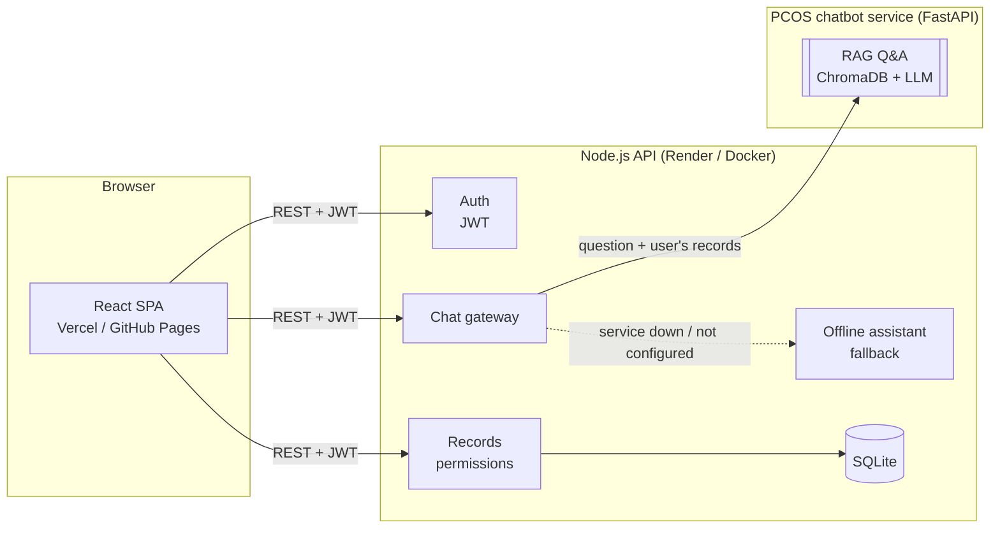

# Sharing App PCOS

A PCOS care app for patients and doctors: a React frontend and a Node.js API built around a smart chatbot that answers questions about PCOS and about each user's own health records.

**Live app:** [pcos-care-assistant.vercel.app](https://pcos-care-assistant.vercel.app) · **API:** [sharing-app-ucsi.onrender.com/api/health](https://sharing-app-ucsi.onrender.com/api/health) · **Chatbot:** [chat-bot-l53v.onrender.com/health](https://chat-bot-l53v.onrender.com/health)

> [!NOTE]
> The API and the chatbot run on Render's free tier and sleep when idle. The first request after a quiet period can take up to a minute.

> [!IMPORTANT]
> The assistant and the PCOS assessment support decisions; they do not diagnose. Androgen and AMH thresholds depend on the assay and the population, and other causes must be ruled out by a clinician.

## Contents

1. [Why this app](#1-why-this-app)
2. [Features](#2-features)
3. [Architecture](#3-architecture)
4. [Getting started](#4-getting-started)
5. [API reference](#5-api-reference)
6. [Deployment](#6-deployment)
7. [Contributing](#7-contributing)
8. [References](#references)
9. [License](#license)

---

## 1. Why this app

Polycystic ovary syndrome (PCOS) affects an estimated 10–13% of women of reproductive age [1]. It is diagnosed when two of three features are present: ovulatory dysfunction, hyperandrogenism and polycystic ovarian morphology [2], [3].

Many PCOS symptoms are sensitive (cycles, hair growth, acne, fertility, weight), so patients often hesitate to ask about them, and short clinic visits leave little time to explain lab results. This app gives patients a judgment-free place to ask, and gives doctors a quick way to follow and summarize their patients' visits.

The chatbot itself lives in a separate repository, the **[PCOS chatbot service](https://github.com/InnovHer-Competition/chat-bot)** (FastAPI + LangChain RAG over curated PCOS documents). This repository is its user interface and gateway.

## 2. Features

- **Smart assistant.** Patients ask about PCOS and their own records; doctors ask about their patients. Answers come from the chatbot service, with a built-in offline assistant as a fallback.
- **Health records.** Visits with cycle data, symptoms, labs and ultrasound findings, with charts of trends over time.
- **PCOS assessment.** Rotterdam criteria evaluated with the 2023 international guideline thresholds, mapped to phenotypes A–D.
- **Role-based access.** Separate patient and doctor accounts with clear rules about who can read, change and delete each record.
- **Demo mode.** Seeded demo accounts so the app can be explored without entering real data.

---

## 3. Architecture

### 3.1 Components



### 3.2 Roles and permissions

| | Patient | Doctor |
|---|---|---|
| Read records | Their own | Any patient's |
| Create and update records | Their own | Any patient's |
| Delete records | Their own | Only records they authored |
| Assistant sees | Their own records | Their patients' records |

The rules are pure functions in [`packages/shared/src/permissions.ts`](packages/shared/src/permissions.ts). The API enforces them, and the UI and the chat gateway reuse them.

### 3.3 Chatbot integration

`POST /api/chat` is the gateway to the chatbot service. For each message it:

1. builds a plain-text summary of the records the signed-in user is allowed to see ([`chat/context.ts`](apps/server/src/chat/context.ts));
2. calls `POST {CHATBOT_URL}/api/v1/chat` ([`chat/client.ts`](apps/server/src/chat/client.ts)) with

   ```json
   { "message": "What is PCOS?", "history": [], "role": "patient", "context": "Signed-in user: … Your records …" }
   ```

   and expects `{ "reply": "…", "module_used": "Module A (RAG Q&A)" }` back;
3. returns the reply to the browser with the header `X-Chat-Mode: chatbot`.

The chatbot service currently reads only `message`, which its RAG retriever uses as the query. FastAPI ignores `history`, `role` and `context` until the service starts using them, so the contract stays backwards compatible.

If `CHATBOT_URL` is not set, or the service fails or times out, a rule-based **offline assistant** answers common questions (what PCOS is, latest findings, BMI, LH:FSH, HOMA-IR, cycle trend) from the user's records and sets `X-Chat-Mode: offline`. Development and demos therefore work without the Python service.

### 3.4 PCOS assessment

[`packages/shared/src/pcos.ts`](packages/shared/src/pcos.ts) evaluates the Rotterdam criteria with the thresholds of the 2023 International Evidence-based Guideline [3]:

- **Ovulatory dysfunction:** cycles longer than 35 or shorter than 21 days, or fewer than 8 periods a year
- **Hyperandrogenism:** modified Ferriman–Gallwey score ≥ 4, acne or alopecia, or total testosterone above the reference range
- **Polycystic ovarian morphology:** ≥ 20 follicles per ovary, or ovarian volume ≥ 10 mL

The latest known value of each measurement is carried forward across visits, so an earlier ultrasound still counts when a later visit only records labs. The result is mapped to phenotypes A–D. Derived metrics include BMI, the LH:FSH ratio and HOMA-IR [4].

### 3.5 Technology stack

| Area | Tools |
|---|---|
| Frontend | [React 19](https://react.dev/), [Vite](https://vite.dev/), [TypeScript](https://www.typescriptlang.org/) (strict), [assistant-ui](https://github.com/assistant-ui/assistant-ui) [5], dependency-free SVG charts with a colour-blind-safe palette |
| Backend | [Express 5](https://expressjs.com/), [node:sqlite](https://nodejs.org/api/sqlite.html), [jose](https://github.com/panva/jose) JWT sessions, scrypt password hashing, [Zod](https://zod.dev/) validation |
| Chatbot service | FastAPI, LangChain, ChromaDB, HuggingFace embeddings, a local Ollama LLM ([separate repository](https://github.com/InnovHer-Competition/chat-bot)) |
| Tooling | [pnpm](https://pnpm.io/) workspaces, [Vitest](https://vitest.dev/) + [Supertest](https://github.com/ladjs/supertest), [oxlint](https://oxc.rs/), GitHub Actions |

### 3.6 Repository layout

```
sharing-app/
├── apps/
│   ├── web/                     # React frontend
│   │   └── src/
│   │       ├── pages/           # Sign in/up, assistant, dashboards, records, account
│   │       ├── components/      # Layout, charts, PCOS overview, record form, patient picker
│   │       ├── chat/            # assistant-ui adapter for /api/chat
│   │       └── lib/             # API client, auth context
│   │
│   └── server/                  # Node.js API
│       ├── src/
│       │   ├── routes/          # auth, records, patients
│       │   ├── chat/            # gateway, chatbot client, record context, offline fallback
│       │   ├── db.ts            # SQLite schema and repository
│       │   └── seed.ts          # demo accounts and records
│       ├── test/                # API tests (auth, permissions, chat gateway)
│       └── Dockerfile
│
├── packages/
│   └── shared/                  # Types, PCOS assessment, permissions (+ tests)
│
├── scripts/dev.mjs              # Runs the API and the web app together (pnpm dev)
├── pnpm-workspace.yaml
└── .github/workflows/ci-cd.yml  # CI, GitHub Pages and GHCR
```

---

## 4. Getting started

### 4.1 Prerequisites

- **Node.js** 22.13 or later (24 LTS recommended; `node:sqlite` is used without flags)
- **pnpm** 11 or later (`corepack enable` picks up the version pinned in `package.json`)
- Optional: the **[PCOS chatbot service](https://github.com/InnovHer-Competition/chat-bot)** (Python 3.11, Ollama) and **Docker** for the API image

### 4.2 Run locally

```bash
git clone https://github.com/InnovHer-Competition/sharing-app.git
cd sharing-app
pnpm install

# Optional: local environment files
cp apps/server/.env.example apps/server/.env
cp apps/web/.env.example apps/web/.env.local

pnpm dev
```

| Service | Address |
|---|---|
| Web app | [localhost:5173](http://localhost:5173) |
| API | [localhost:8787/api/health](http://localhost:8787/api/health) (reports `"chat": "chatbot"` or `"offline"`) |
| Chatbot service | [localhost:8000/docs](http://localhost:8000/docs) |

To use the real chatbot instead of the offline assistant, start the chatbot service in its own checkout (see its README) and keep `CHATBOT_URL=http://localhost:8000` in `apps/server/.env`:

```bash
conda activate pcos-env
python run_ingest.py               # builds data/chroma_db once
uvicorn app.main:app --port 8000
```

### 4.3 Demo accounts

With `SEED_DEMO=true` (the default outside production), an empty database is seeded with these accounts. They all use the password `Demo1234!`.

| Email | Role | Notes |
|---|---|---|
| `anna@demo.health` | Patient | 5 visits showing treatment response |
| `mai@demo.health` | Patient | Phenotype C |
| `linh@demo.health` | Patient | One visit, phenotype D |
| `dr.le@demo.health` | Doctor | Author of Anna's and Mai's visits |
| `dr.kim@demo.health` | Doctor | Author of Linh's visit |

### 4.4 Commands

```bash
pnpm dev             # Start the API (8787) and the web app (5173)
pnpm build           # Build all workspaces
pnpm build:server    # Build only the API (used on Render)
pnpm start           # Run the built API (used on Render)
pnpm typecheck       # TypeScript checks across the workspace
pnpm lint            # Lint with oxlint
pnpm test            # Shared and API test suites
```

### 4.5 Configuration

| Variable | App | Default | Purpose |
|---|---|---|---|
| `VITE_API_URL` | web | `http://localhost:8787` | API base URL |
| `VITE_SHOW_DEMO_ACCOUNTS` | web | `true` | Show demo shortcuts on the sign-in page |
| `PORT` | server | `8787` | HTTP port |
| `DATABASE_PATH` | server | `./data/pcos.db` | SQLite file |
| `CORS_ORIGIN` | server | `http://localhost:5173` | Allowed browser origins (comma-separated) |
| `JWT_SECRET` | server | random in dev | **Required in production** |
| `JWT_TTL` | server | `8h` | Session lifetime |
| `SEED_DEMO` | server | `true` (dev) / `false` (prod) | Seed demo data into an empty database |
| `CHATBOT_URL` | server | — | Base URL of the chatbot service; the offline assistant answers when unset |
| `CHATBOT_TOKEN` | server | — | Optional bearer token sent to the chatbot service |
| `CHATBOT_TIMEOUT_MS` | server | `120000` | How long to wait for a chatbot reply before falling back |

---

## 5. API reference

All routes are under `/api`. Everything except sign-up and sign-in requires `Authorization: Bearer <token>`.

| Method | Path | Who | Description |
|---|---|---|---|
| `POST` | `/auth/signup` | anyone | Create an account `{ name, email, password, role }` (`patient` or `doctor`) |
| `POST` | `/auth/signin` | anyone | Sign in with email and password |
| `GET` | `/auth/me` | signed in | Current user |
| `GET` | `/records[?patientId=]` | signed in | List the records the user can read |
| `GET` · `PUT` · `DELETE` | `/records/:id` | per permissions | Read, replace or delete a record |
| `POST` | `/records` | signed in | Create a record |
| `GET` | `/patients` | doctor | Patient directory |
| `POST` | `/chat` | signed in | `{ messages }` → plain-text reply from the assistant ([§3.3](#33-chatbot-integration)) |

---

## 6. Deployment

### 6.1 CI/CD

[`.github/workflows/ci-cd.yml`](.github/workflows/ci-cd.yml) runs on every pull request and on every push to `main`:

| Job | Runs on | What it does |
|---|---|---|
| `test` | PRs and `main` | `pnpm install --frozen-lockfile`, lint, typecheck, tests, build |
| `deploy-web` | `main` | Builds the frontend and deploys it to **GitHub Pages** |
| `publish-server` | `main` | Builds `apps/server/Dockerfile`, pushes `ghcr.io/<owner>/<repo>-api:latest` and `:sha-…`, and calls the Render deploy hook when `API_DEPLOY_HOOK` is set |

### 6.2 Frontend on Vercel (live)

The live frontend is the Vercel project `sharing-app` (framework preset **Vite**). It deploys from `main` on every push and is served at **[pcos-care-assistant.vercel.app](https://pcos-care-assistant.vercel.app)**. The older address `sharing-app-eight.vercel.app` points to the same deployment.

- Set `VITE_API_URL` to the Render API URL (no trailing slash) in the Vercel project's environment variables.
- List every frontend address in the API's `CORS_ORIGIN`, comma-separated, e.g. `https://pcos-care-assistant.vercel.app,https://sharing-app-eight.vercel.app,https://innovher-competition.github.io`.

### 6.3 Frontend on GitHub Pages

1. **Settings → Pages → Source:** choose **GitHub Actions**.
2. **Settings → Secrets and variables → Actions → Variables:**
   - `API_URL`: public URL of the deployed API, e.g. `https://<service>.onrender.com`
   - `SHOW_DEMO_ACCOUNTS` *(optional)*: `false` to hide the demo shortcuts
3. Push to `main`. The site is published at `https://<owner>.github.io/<repo>/`, which for this repository is [innovher-competition.github.io/sharing-app](https://innovher-competition.github.io/sharing-app/).

### 6.4 Backend on Render (live)

The API runs on **[Render](https://render.com)** with the Node runtime, built from the repository root.

| Setting | Value |
|---|---|
| Runtime | Node (version pinned to 24 by [`.node-version`](.node-version)) |
| Branch | `main` |
| Root directory | *(empty: repository root)* |
| Build command | `pnpm install --frozen-lockfile && pnpm build:server` |
| Start command | `pnpm start` |
| Health check path | `/api/health` |

**Environment variables:** `NODE_ENV=production`, `JWT_SECRET` (a random secret), `CORS_ORIGIN` (every frontend address, see [§6.2](#62-frontend-on-vercel-live)), `SEED_DEMO`, `CHATBOT_URL` (public URL of the deployed chatbot service), and `DATABASE_PATH=/var/data/pcos.db` when a disk is mounted at `/var/data`. Render sets `PORT` itself.

To connect the GitHub Pages frontend, add the service URL (no trailing slash) as the `API_URL` repository variable and re-run the CI/CD workflow.

### 6.5 Backend with Docker

```bash
# Build from the repository root
docker build -f apps/server/Dockerfile -t pcos-sharing-app-api .

# Run with a persistent volume for the database
docker run -p 8787:8787 -v pcos-data:/data \
  -e JWT_SECRET=<random 64-hex> \
  -e CORS_ORIGIN=https://innovher-competition.github.io \
  -e CHATBOT_URL=https://<chatbot-service-host> \
  -e SEED_DEMO=true \
  pcos-sharing-app-api
```

### 6.6 Troubleshooting

| Symptom | Fix |
|---|---|
| `405` on `/api/auth/signin` | `API_URL` / `VITE_API_URL` is not set, or the frontend was not rebuilt after setting it |
| CORS error in the browser console | Add the site's address to `CORS_ORIGIN` exactly as the browser shows it (no path, no trailing slash) |
| Assistant says the chatbot service is unavailable | `CHATBOT_URL` is wrong or the service is down; check `{CHATBOT_URL}/docs` |
| Demo accounts missing | Set `SEED_DEMO=true`; seeding only runs on an empty database |
| Data disappears after a deploy | Attach a persistent disk and set `DATABASE_PATH` |
| `JWT_SECRET must be set in production` | Add `JWT_SECRET` to the service's environment |

> [!WARNING]
> Before handling real patient data, review the deployment against the health-data rules that apply to you (e.g. GDPR, HIPAA): serve over HTTPS only, encrypt the database volume at rest, set `SEED_DEMO=false`, rotate `JWT_SECRET`, and secure the link to the chatbot service, which receives the user's records as context.

---

## 7. Contributing

Contributions are welcome. Open a pull request against `main`; CI must pass (lint, typecheck, tests, build). Commit message conventions are in [CONTRIBUTING.md](CONTRIBUTING.md).

---

## References

[1] World Health Organization. *Polycystic ovary syndrome* (fact sheet), 2023. Available: https://www.who.int/news-room/fact-sheets/detail/polycystic-ovary-syndrome

[2] Rotterdam ESHRE/ASRM-Sponsored PCOS Consensus Workshop Group. Revised 2003 consensus on diagnostic criteria and long-term health risks related to polycystic ovary syndrome. *Fertility and Sterility*, 81(1):19–25, 2004.

[3] H. J. Teede et al. Recommendations from the 2023 International Evidence-based Guideline for the Assessment and Management of Polycystic Ovary Syndrome. *Fertility and Sterility*, 120(4):767–793, 2023.

[4] D. R. Matthews et al. Homeostasis model assessment: insulin resistance and β-cell function from fasting plasma glucose and insulin concentrations in man. *Diabetologia*, 28:412–419, 1985.

[5] assistant-ui: React components for AI chat. Available: https://github.com/assistant-ui/assistant-ui

---

## License

Released under the [MIT License](LICENSE).
